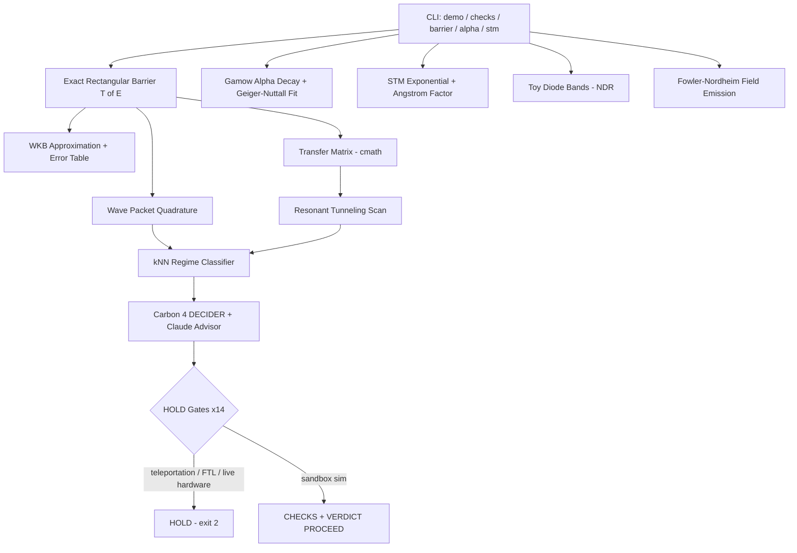
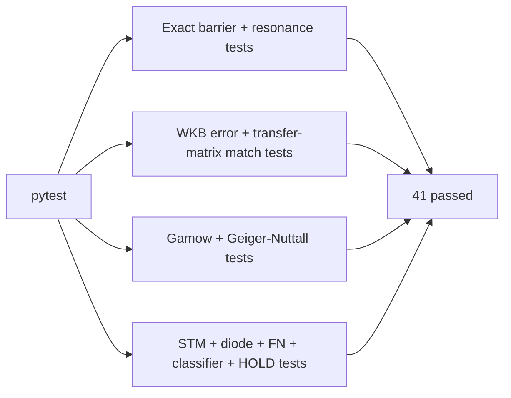
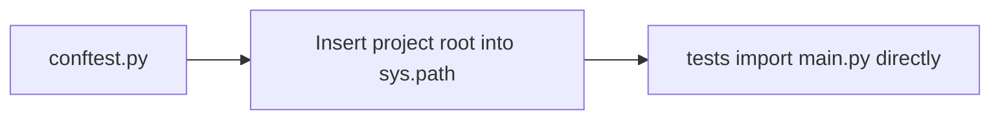
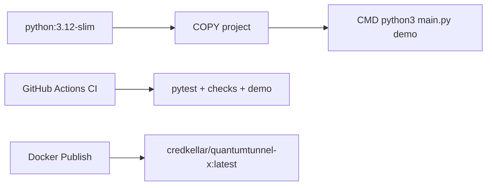

# QuantumTunnel-X 🌌⚛️

**Quantum Tunneling Physics Lab** — an educational quantum tunneling lab in ONE pure-Python file, by Darion Kellar. The **exact** transmission coefficient for a rectangular barrier, the **WKB approximation with its error measured**, a **Gamow-factor alpha-decay model** that lands within a whisker of the real half-lives, **STM** current vs gap, a labelled **toy tunnel-diode** band model, **resonant tunneling** by transfer matrix, and **Fowler–Nordheim field emission**. Simulation and learning only — tunneling is *not* teleportation and *not* faster than light, and every real-world operation sits behind a permanent HOLD gate (14 total). 🔒


> ℹ️ The two workflow badges above are the **live** GitHub Actions badges for this repo — they light up as soon as the `ci.yml` and `docker-publish.yml` files from the paste pack are pasted into `.github/workflows/`.

## 🧰 Tech Stack Badges & Full Architecture Tech Stack

### 💻 Core Programming Languages & Core Systems


- 🐍 Python 3.12, pure standard library (`math`, `cmath`, `hashlib`, `json`, `sys`) — ONE file: `main.py`
- ⚛️ Physics core: exact rectangular-barrier T(E) in all three regimes (below / at / above V0), WKB approximation with quantified error, Gaussian wave-packet average by quadrature, Gamow closed form for alpha decay, STM exponential, toy diode bands, transfer-matrix multilayer solver, Fowler–Nordheim law
- 🧠 TinyML kNN regime classifier (from scratch, stdlib) on (E/V0, log10(κa + 1), log10 mass ratio)
- 🧑‍⚖️ Advisory seats inside `main.py`: Gemini Carbon 4 DECIDER (names-only, tighten-only, sha256 trace), Muse advisor (can_override_hold = False), Google Flow plan-only (rendered = False, live = 0)

### ⛓️ Web3 & Infrastructure

Not used — this lab is an offline physics simulation. No blockchain, no Web3 libraries, no network calls of any kind.

### ⚙️ Platform Support & Hardware Architecture


- 🖥️ Runs anywhere Python 3.12 runs — Linux, macOS, Windows, any CPU architecture
- 🚫 Controls **no hardware**: no STM tips, diode rigs, emitters, or radiation sources (all behind HOLD gates)

### ⚡ Low-Level Infrastructure & Performance


- 🚀 Zero dependencies, zero network, zero install friction for the lab itself
- 🎯 Deterministic end to end: run it twice, get byte-identical output
- 🔢 Complex transfer matrices from stdlib `cmath` — no numpy, no compiled code

### 🛠️ DevOps & Build Tools


- 🐳 Docker image (`python:3.12-slim`), target: `credkellar/quantumtunnel-x:latest`
- ⚙️ GitHub Actions CI + Docker Publish workflows — delivered in the paste pack for `.github/workflows/`

### ☁️ Cloud Providers

Not used — this lab runs fully offline on your own machine or in a local Docker container. No cloud account, no API keys, no hosted services.

## What this does?

1. 🌊 **Exact rectangular barrier** — T(E) in closed form for E < V0 (sinh), E = V0 (the limit), and E > V0 (sin): an electron at half height through a 1 nm, 2 eV barrier passes with T = 1.42e-4, and above the barrier T hits **exactly 1** whenever k2·a = nπ.
2. 📉 **WKB, graded** — the famous exp(−2κa) shortcut is scored against the exact answer at six energies: it misses the prefactor 16·E·(V0−E)/V0² mid-range (exact/WKB = 4.00 at E = V0/2) and near the top it *over*estimates ×3.9, sending T → 1 where the exact T stays ≈ 0.06. Where WKB breaks is printed, not hidden.
3. 🎲 **Wave packet** — a Gaussian energy spread averaged over the exact T(E) by deterministic quadrature (method stated in the docstring): a σ = 0.30 eV packet at E0 = 1.0 eV transmits 6.38e-4 vs 1.42e-4 mono-energetic — the high-energy tail leaks through.
4. ☢️ **Alpha decay (Gamow)** — closed-form Gamow exponent + assault frequency for three **labelled model nuclei**: U-238-like t½ = 4.63e9 yr (real ≈ 4.5e9), Ra-226-like 1,065 yr (real ≈ 1,600), Po-212-like 1.66e-7 s (real ≈ 3.0e-7). Paper only — radiation sources are a HOLD gate.
5. 📏 **Geiger–Nuttall law** — at fixed Z, log10(t½) vs 1/√Q fits a straight line with r = 0.99996, and +1 MeV of Q (5 → 6 MeV at Z = 86) shrinks the half-life ×3.26e5. Small push, astronomical effect.
6. 🔬 **STM** — I ∝ exp(−2κd) with κ = 11.456 /nm at φ = 5.0 eV: one ångström closer multiplies the current ×9.89 (computed, not rounded to 10), and a 1% current change is a 0.43 pm height change — that is why STM resolves atoms.
7. 📟 **Tunnel diode (toy model)** — a *labelled toy* band-overlap model: tunnel current peaks at Vp = 0.10 V (1.017 mA), falls through a negative-differential-resistance region (dI/dV = −2.37 at 0.30 V), valleys at 0.52 V — peak/valley ratio 4.09 — then diffusion current takes over.
8. 🎯 **Resonant tunneling** — a barrier/well/barrier stack solved exactly by transfer matrix: at E = 0.9467 eV the pair of walls transmits T = 0.9999, while ONE solid 2 nm barrier at the same energy passes only 7.2e-3. Off resonance, T collapses to 4.4e-2 and below.
9. ⚡ **Field emission** — Fowler–Nordheim J(E) with the standard constants: J climbs from 9.5e-3 A/m² at 2e9 V/m to 1.5e9 A/m² at 7e9 V/m, and the FN-plot slope identity (exactly −B·φ^1.5) is verified numerically.
10. 🏷️ **kNN regime classifier** — labels any (E, V0, width, mass) point `tunneling-dominant` / `mixed` / `classical-over-barrier` from physical features.
11. 🧠 **Advisory seats + checks** — Carbon 4 DECIDER with sha256 trace, Muse advisor, Google Flow plan-only, and a built-in CHECKS suite (50 checks).

## 🗺️ How it works — diagram per script

### `main.py` — the whole lab



### `tests/test_main.py` — verification



### `conftest.py` — test path setup



### `Dockerfile` + CI — container & workflow flow



## Why is this cool?

1. 🌊 Tunneling stops being a magic word: one formula gives the exact odds for any barrier, and the lab proves the formula against its own transfer-matrix solver to 1e-9.
2. 📉 The WKB shortcut everyone quotes gets a report card — right mid-range within a known prefactor, wrong ×3.9 near the top — so you learn *when* to trust it.
3. ☢️ Three lines of Gamow math reproduce 25 orders of magnitude of real nuclear half-lives, from 0.17 microseconds to 4.6 billion years, with no fitted parameters.
4. 📏 The Geiger–Nuttall straight line (r = 0.99996) falls out of the model on its own — a 1911 empirical law derived, not asserted.
5. 🔬 The STM's atomic vision is one exponential: ×9.89 current per ångström, 0.43 pm per percent. The cover-worthy microscope is arithmetic.
6. 🎯 Two walls that each block 99.3% become 99.99% transparent at one energy — resonant tunneling is the strangest honest result in the lab, and it is exact.
7. 📟 A current that falls while voltage rises (the tunnel diode's NDR) emerges from a two-line toy band model you can read in a minute.
8. ⚡ Field emission shows the same exponential wearing a different hat: bend the barrier into a triangle with voltage and electrons pour out.
9. 🎲 The wave-packet section teaches the difference between a particle *at* an energy and a particle *around* an energy — and prices it (×4.5 transmission).
10. 🎯 Deterministic end to end: run it twice, get byte-identical output — tunneling you can diff.

## What problems this solves?

1. ❌ **Problem:** "Quantum tunneling" is used as a synonym for teleportation in pop science. ✅ **Solution:** The lab shows a wave decaying inside a barrier and emerging smaller — and teleportation/FTL claims are permanent HOLD gates.
2. ❌ **Problem:** WKB numbers get quoted with no idea of their error. ✅ **Solution:** Every WKB value is printed next to the exact T with the ratio, and the failure regions are named.
3. ❌ **Problem:** Alpha-decay half-lives look arbitrary (microseconds to billions of years). ✅ **Solution:** One Gamow exponent explains the whole range, and the Geiger–Nuttall fit shows the pattern is a straight line in 1/√Q.
4. ❌ **Problem:** STM atomic resolution sounds like marketing. ✅ **Solution:** The ångström factor (×9.89) and the 0.43 pm-per-percent figure are computed from κ, not asserted.
5. ❌ **Problem:** Resonant tunneling is usually hand-waved with a picture. ✅ **Solution:** A transfer-matrix solver computes it exactly, and the same solver is validated against the analytic single-barrier formula.
6. ❌ **Problem:** Negative resistance seems impossible to beginners. ✅ **Solution:** The toy diode separates the tunnel and diffusion currents so the falling region has a visible cause.
7. ❌ **Problem:** Students meet tunneling as one formula for one barrier shape. ✅ **Solution:** Eight connected phenomena — decay, microscopy, diodes, resonance, emission — all reduce to the same κ.
8. ❌ **Problem:** Physics code usually needs numpy/scipy installs. ✅ **Solution:** Pure standard library, `cmath` included — runs anywhere Python 3.12 runs.
9. ❌ **Problem:** Toy models quietly pose as device engineering. ✅ **Solution:** The diode is labelled TOY everywhere it appears, model nuclei are labelled models, and fabrication/performance claims are HOLD gates.
10. ❌ **Problem:** Simulation tools imply lab readiness. ✅ **Solution:** Live experiments, high voltage, cryogenics, and radiation handling are all permanent HOLD gates returning exit code 2.

## How to install this?

1. 📋 Clone or download this project folder.
2. 🐍 Make sure Python 3.12+ is installed: `python3 --version`
3. ▶️ Run the full demo + checks (no arguments needed):

```bash
python3 main.py
```

4. 🧪 Run the test suite:

```bash
pip install pytest
python3 -m pytest -q
```

5. 🎛️ Try the other commands:

```bash
python3 main.py checks     # 50 built-in checks
python3 main.py barrier    # exact T vs WKB across energies
python3 main.py wkb        # the WKB error table as JSON
python3 main.py packet     # wave-packet transmission vs sigma
python3 main.py alpha      # Gamow half-lives of the model nuclei (JSON)
python3 main.py stm        # STM current vs gap + angstrom factor
python3 main.py diode      # toy tunnel-diode I-V curve + peak/valley
python3 main.py resonance  # resonant-tunneling scan + T table
python3 main.py field      # Fowler-Nordheim J vs field
python3 main.py classify   # kNN regime verdicts
python3 main.py brains     # Carbon 4 + Muse + Flow seats
python3 main.py holds      # list all 14 HOLD gates
python3 main.py hold-demo  # exits 2 - gated actions stay HOLD
```

6. 🐳 Or run it in Docker:

```bash
docker build -t credkellar/quantumtunnel-x:latest .
docker run --rm credkellar/quantumtunnel-x:latest
```

## Requirements

- 🐍 Python 3.12 or newer
- 📦 Dependencies: **none** (standard library only)
- 🌐 Network: **none** — fully offline
- 🧪 For tests only: `pytest`
- 🐳 Optional: Docker

## FULL project structure tree

```text
quantumtunnel-x/
├── main.py                  # the whole lab: exact barrier, WKB, packet, Gamow, STM, diode, resonance, FN, classifier, seats, HOLD gates
├── conftest.py              # puts the project root on sys.path for tests
├── tests/
│   └── test_main.py         # 41 pytest tests: barrier, WKB, TM match, Gamow, STM, diode, resonance, FN, gates, determinism
├── assets/
│   └── cover.png            # README cover image (2736 x 912)
├── Dockerfile               # python:3.12-slim, runs the demo
├── .gitignore               # __pycache__, .pytest_cache, *.pyc
└── README.md                # this file
```

> 📦 Delivered separately as paste packs (not in this tree): `.github/workflows/ci.yml` + `docker-publish.yml`, and the Docker Hub pack (100-char description, 350-char About, overview, categories).

## 🔒 HOLD gates — all 14, permanent

| Gate | Rule |
|---|---|
| real_hardware_control | No control of any real STM, diode rig, or lab hardware, ever |
| live_experiment | No live experiment instructions; this lab computes, it does not operate |
| claim_ftl | Tunneling is not faster-than-light travel or communication; causality stands |
| teleportation_claim | Tunneling is not teleportation; the particle crosses the barrier region as a wave |
| commercial_product_claim | Educational lab, not a commercial product or device design |
| semiconductor_fabrication_claim | No fabrication recipes; toy band models are not process engineering |
| medical_claim | No medical claims |
| weapons_application_claim | No weapons application guidance of any kind |
| free_energy_claim | Tunneling creates no energy; transmitted particles keep the energy they had |
| investment_claim | No investment advice about tunneling, chip, or quantum companies |
| live_cryogenics | No live cryogenics handling instructions for hardware builds |
| high_voltage_live | No live high-voltage work; field-emission numbers are a model, not a wiring guide |
| radiation_source_live | Alpha decay is modelled on paper only; no radiation source handling, ever |
| guaranteed_device_performance_claim | No guaranteed device performance; every model carries its assumptions |

🧑‍⚖️ **Seats:** Gemini Carbon 4 DECIDER (MAP→MODEL→STRESS→DECIDE, names-only, tighten-only, sha256 trace) · Muse advisor (can_override_hold = False) · Google Flow plan-only (rendered = False, live = 0).

✅ **Verification:** pytest 41 passed · CHECKS 50/50 · double-run byte-identical · hold-demo exits 2.

## 🧒 5th-grade English section

Imagine you are rolling a ball at a hill. If the ball is too slow, it rolls back — every time. That is the normal world. 🏀

- In the tiny quantum world, the ball is also a **wave**, like a ripple. When the ripple hits the hill, most of it bounces back — but a tiny bit of the ripple **leaks through** and comes out the other side. That leak is called **tunneling**. 🌊
- The thicker the hill, the smaller the leak. Twice as thick does not mean half as much — it means **way, way** less, because the leak shrinks by multiplying, not by subtracting. 📉
- This is real! It is how the sun's atoms and some radioactive rocks slowly change (the tiny piece leaks out after trying billions of times a second), and how a special microscope can "feel" single atoms — move the needle a hair closer and the leak grows almost **ten times**. 🔬
- Sometimes two thin hills with a dip between them let the ripple through **almost perfectly** at one special speed — like a secret password. 🎯
- Tunneling is **not** teleporting and **not** faster than light. The ripple still travels, and most of it bounces back. 🚫
- This project is a **pretend lab on a computer**. It does the math of the leak — it does not build anything or touch anything real. 💻

---

MIT © 2026 Darion Kellar · QuantumTunnel-X — educational simulation only 🌌
